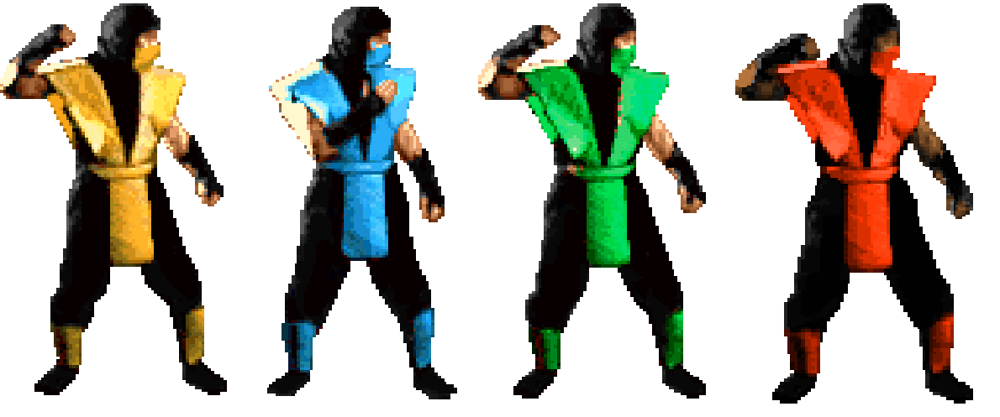
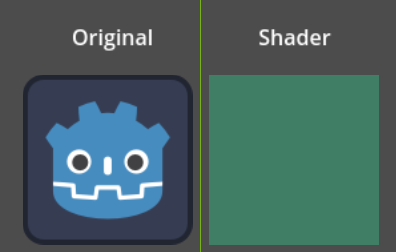
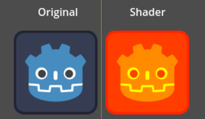
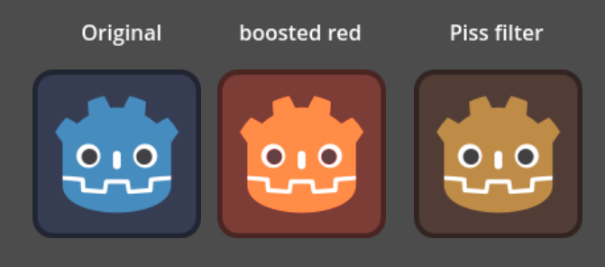
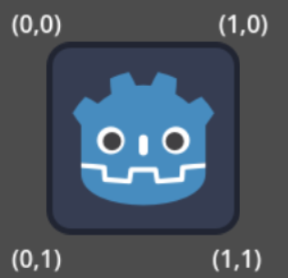
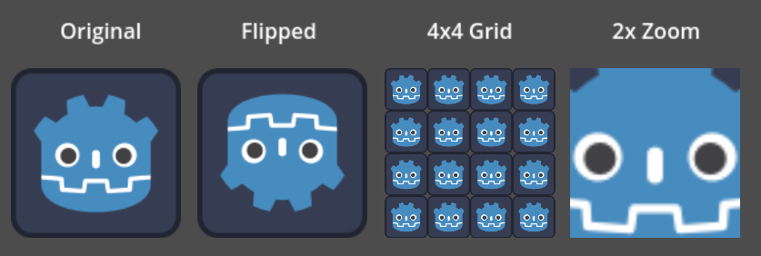
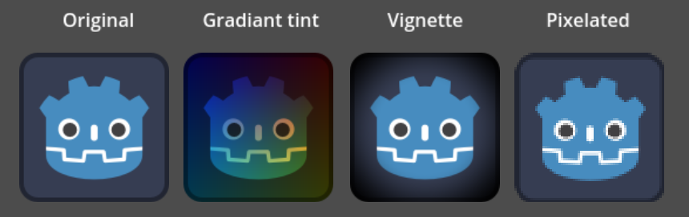

# Godot_shaders
A step by step tutorial to learn godot shaders from the very beginning


### Prerequisites
* **Godot Engine:** Version 4.0 or higher.
### Getting started
First off : What are SHADERS ?
Shaders run code on the GPU for every single pixel or vertex simultaneously. Shaders operate on data in the graphics pipeline to control the rendering of an image. Still don't get it? Imagine if you're making mortal kombat (the original). You have a very limited memory but you want to have multiple characters. Scorpion, Subzero, Reptile and other ninja characters are basically the same but with different colors. That's a waste of precious space!

If only you could have one of these sprites and change the color whenever you want... well you can! This is the simplest task a shader can do for you.

Now let's get started. Open godot. Slap Sprite2D onto a node and go to the inspector(load the good old godot logo). Under CanvasItem you'll find Material. Right now it's empty. Click on it and make a NewShaderMaterial. See the white ball? That is your sprite's material(which is nothing right now). Under the ball there's a shader section. click it and create a new shader. Congratulations! Your ball is now flattened! The white square (formally your ball) shows what effect is currently applied to your sprite. Click your shader to open Shader Editor.

**Note:** You can wriye comments using ```//```. Also don't forget every command has to end with ```;```.

```gdscript
shader_type canvas_item;
// detremines it's a 2D shader file

void vertex() {
	// Called for every vertex the material is visible on.
}

void fragment() {
	// Called for every pixel the material is visible on.
}
```
Before your sprite get's rendered you can change it's shape, position and geometry using ```void vertex()```. You basically change the vertices. Decide which one's you want to keep, delete, move and etc.
Now that your sprite has taken shape it's time for the pixels to be rendered. With ```void fragment()``` you have control over each pixel. This where we're gonna change the colors of our ninjas.
These two functions are executed before every node is rendered (unless the node is hidden). That's why you can *animate* your images.
**Quick summary:** ```void vertex()``` changes shape and ```void fragment()``` changes color. 

Let's get started. With ```COLOR``` you can determine the color (duh). It is a vector4D and has (r,g,b,a) values varying from 0 to 1.

```
void fragment(){
	COLOR = vec4(0.25,0.5,0.4,1.0);
}
```
Code above will just assign the color to all pixels. But we want to make an evil version of godot. So we should take every blue pixel and make it red in the same channel. This can be simply done with a variable.

```
void fragment() {
	vec4 evil = texture(TEXTURE,UV);
	evil.b=0.0;
	evil.r=1.0;
	COLOR = evil;
	}
```
`texture(TEXTURE, UV)` looks up the color of the sprite's image at this pixel's position `(UV)` and returns it as a vec4 `(R, G, B, A)`. Stored in a variable called `evil`. Then the blue channel is set to zero and red channel is maximized. At last `evil` is assigned to `COLOR` to apply the changes.
But this one doesn't look that good. Every pixel keeps its green and alpha (transparency), but blue is removed and red is maxed. Areas that were pure blue become dark red (since G=0, R=1, B=0 → red). Areas that were white become yellow (R=1, G=1, B=0). Areas that were black stay black.
Let's do it another way. Swapping blue and red replaces each channel's value with the other's. Basically (R,G,B,A) will be (B,G,R,A) and it will be cleaner. 
```
void fragment() {
    vec4 evil = texture(TEXTURE, UV);
    evil.rb = evil.br;      // swap red and blue
    evil.r = min(evil.r * 1.5, 1.0);  // boost red
    COLOR = evil;
}
```
`min(color.r * 1.5, 1.0)` multiplies red by 1.5, then clamps it so it never exceeds 1.0. Without this line it looked like the good old piss filter. Only swapping and changing colors aren't enough. Play with the values until you are happy with the outcome.


### What's texture(TEXTURE, UV)?
`texture()` is the built-in GLSL (which godot's shader language is bulit on) function that reads from an image. `TEXTURE` is the image itself. Godot automatically passes your sprite's texture in as this variable. `UV` is a pair of numbers `(u, v)` that says where on a texture you are looking. `U` is the horizontal axis where 0 is left and 1 is right. `V` is the vertical axis where 0 is top and 1 is bottom.
So the positions of an image look like this:
The center will be (0.5,0.5). Between vertices, UV is interpolated smoothly. A pixel halfway across the sprite gets UV ≈ (0.5, 0.5). So every pixel in the sprite has a UV pointing to its spot on the image. By using this method the shader will work fine on any image of any size, regardless of resolution.

### Diving deeper into UV
Here are some more examples of UV:

**Flipped**
```
void fragment() {
    vec2 uv = UV;
    uv.y = 1.0 - uv.y;
    COLOR = texture(TEXTURE, uv);
}
```
**Repeat image**
```
void fragment() {
    vec2 uv = fract(UV * 4.0);  // 4×4 grid
    COLOR = texture(TEXTURE, uv);
}
```
`fract()` returns the fractional part of a number. The digits after the decimal point, dropping the whole number.
`UV * 4.0` → range becomes 0-4 across the sprite.
`fract()` → wraps it into four 0-1 cycles.

**2x Zoom**
```
void fragment() {
    vec2 uv = (UV - 0.5) * 0.5 + 0.5;  // shrink UV range around center
    COLOR = texture(TEXTURE, uv);
}
```



**Gradiant tint**
```
void fragment() {
    vec4 c = texture(TEXTURE, UV);
    c.rgb *= vec3(UV.x, UV.y, 1.0 - UV.x);  // tint varies across the image
    COLOR = c;
}
```
**Vignette**
```
void fragment() {
    vec4 c = texture(TEXTURE, UV);
    float d = distance(UV, vec2(0.5));
    c.rgb *= smoothstep(0.7, 0.3, d);
    COLOR = c;
}
```
`smoothstep(a,b,x)` gives a smooth transition from a to b. Use `step(a,x)` instead to get a sharp circle in this case.
**Pixelate**
```
void fragment() {
    vec2 tex_size = vec2(64.0);     // pretend texture is 64×64
    vec2 uv = floor(UV * tex_size) / tex_size;
    COLOR = texture(TEXTURE, uv);
}
```